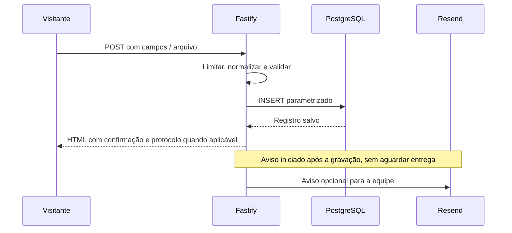

# 02 — Backend, telas e fluxos

> Fontes: `src/routes/site.ts`, `src/routes/forms.ts`, `src/routes/admin.ts`
> e `src/server.ts`.

## Rotas públicas

| Método e rota | Função |
|---|---|
| `GET /` | Home, serviços e vitrine dos aplicativos |
| `GET /afirma-evias` | História e apresentação da empresa |
| `GET /servicos` | Áreas de atuação |
| `GET /aplicativo` | Apresentação dos aplicativos, com imagens locais |
| `GET /acreditacao-e-certificacao` | Certificação e conteúdo institucional |
| `GET /programa-de-integridade` | Programa, link externo e formulário direto |
| `GET /trabalhe-com-a-gente` | Formulário de candidatura |
| `GET /contato` | Formulário, endereços e canais de atendimento |
| `GET /politica-de-privacidade` | Política e informações de cookies |
| `GET /termos-de-uso` | Termos publicados |
| `GET /portal-do-titular` | Pedido de titular |
| `GET /acessibilidade` | Declaração de acessibilidade |
| `GET /bruno_magalhaes` | Página extra com YouTube; marcada como não indexável |
| `GET /protocolo/:codigo` | Consulta limitada do andamento de um protocolo |
| `GET /robots.txt` e `GET /sitemap.xml` | Orientação de rastreamento e mapa público |
| `GET /health` | Executa `SELECT 1` e responde `{ ok: true }` |
| `POST /contato` | Grava contato comercial |
| `POST /trabalhe-com-a-gente` | Grava candidatura e currículo |
| `POST /programa-de-integridade` | Grava relato direto e gera protocolo `INT` |
| `POST /portal-do-titular` | Grava solicitação e gera protocolo `LGPD` |
| `POST /api/consentimento` | Registra a escolha de cookies; retorna JSON |

O sitemap contém 12 páginas institucionais; não inclui a página extra, o painel
nem consultas de protocolo. `robots.txt` desautoriza `/admin`, mas não substitui
a autenticação. Rotas inexistentes e erros recebem páginas próprias.

## Fluxo de envio

Erros de validação retornam HTTP 400 com mensagens e valores para correção.
O contato possui campo honeypot `website`; preenchido, o handler redireciona
sem salvar o contato. Contato e candidatura exigem aceite; o pedido de titular
exige confirmação de titularidade. O relato direto permite anonimato e não
grava nome ou e-mail quando a opção anônima está selecionada.

O currículo é obrigatório, aceita PDF/DOC/DOCX até 5 MiB e tem conferência de
tipo, extensão e assinatura inicial do arquivo. A candidatura usa multipart;
os demais formulários usam campos convencionais. Não há envio do arquivo à Resend.

## Protocolos

`src/utils.ts` gera `PREFIXO-AAAA-XXXXXX` com três bytes aleatórios. O banco exige
unicidade. A consulta pública expõe protocolo, status e datas; para LGPD inclui
o tipo e o prazo. Não retorna nome, e-mail, texto do pedido, relato ou resposta
interna. Quem possui o código consegue consultar esses metadados.

O prazo da solicitação LGPD nasce no banco como `now() + interval '15 days'`.
O painel destaca pedidos abertos com prazo inferior a cinco dias, incluindo
os vencidos. O prazo é um comportamento do produto; não há envio automático de
resposta ao titular.

## Painel administrativo

Todas as rotas abaixo usam o prefixo `/admin`. As coleções são `contatos`,
`candidaturas`, `relatos`, `lgpd` e `consentimentos`.

| Método e caminho após o prefixo | Comportamento |
|---|---|
| `GET /login`, `POST /login` | Entrada com e-mail e senha |
| `POST /sair` | Encerra a sessão |
| `GET /` | Indicadores e registros recentes |
| `GET /dados/:colecao` | Busca, filtro e paginação de 25 registros |
| `GET /dados/:colecao/:id` | Detalhe sem carregar colunas binárias |
| `POST /dados/:colecao/:id` | Atualiza status, observação ou resposta aplicável |
| `POST /dados/:colecao/:id/excluir` | Exclusão definitiva, somente admin |
| `GET /dados/candidaturas/:id/arquivo` | Download autenticado do currículo |
| `GET /dados/:colecao/exportar.csv` | Exporta até 5.000 registros da coleção |
| `GET /auditoria` | Eventos em páginas de 50 registros |
| `GET /usuarios` | Lista de usuários e tela de alteração da própria senha |
| `POST /usuarios` | Criação de usuário, somente admin |
| `POST /usuarios/:id/alternar` | Ativa/desativa usuário, somente admin |
| `POST /minha-senha` | Troca a própria senha e encerra as sessões da conta |

A exportação usa as colunas declaradas em `colecoes`, ordena pelos registros
mais recentes e não aplica os filtros da tela de listagem. As respostas de LGPD
e integridade são armazenadas no banco; o handler de atualização não as envia
por e-mail. Marcar LGPD como atendida ou recusada preenche `respondida_em`.
