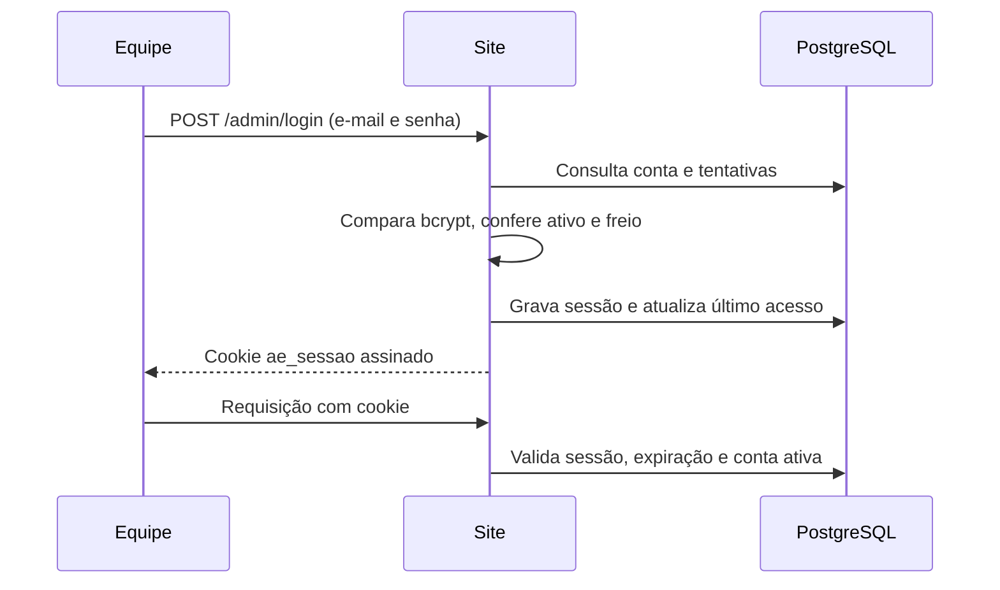

# 04 — Segurança, acesso e auditoria

> Fontes: `src/auth.ts`, `src/audit.ts`, `src/routes/admin.ts`,
> `src/server.ts`, `src/utils.ts` e `db/schema.sql`.

## Autenticação do painel

A autenticação é local ao site, sem JWT nem chamadas a `aevias-auth`. O token
tem 32 bytes aleatórios, é salvo em `admin_sessoes` e tem duração fixa de 12 horas.
O cookie é assinado com `SESSION_SECRET`, `HttpOnly`, `SameSite=Lax`, caminho `/`
e `Secure` em produção. A assinatura não cifra o conteúdo do cookie.

Senhas usam bcrypt com custo 12. Criação pelo painel e troca de senha exigem
pelo menos dez caracteres; a criação inicial pela migration não passa por essa
validação do painel. A troca exige senha atual, confirma a nova e remove todas
as sessões da conta. Desativar a conta impede seu uso na próxima requisição.

O login recebe limite de dez requisições por IP em 15 minutos. Há ainda freio
após oito falhas por e-mail em 15 minutos, persistido no banco. A resposta de
falha é genérica, e contas ausentes/inativas também passam por comparação bcrypt.
O plugin de limite por IP usa armazenamento padrão em memória do processo.

## Permissões efetivas

| Ação | Editor ativo | Admin ativo |
|---|---|---|
| Listar e ler as cinco coleções, incluindo relatos | Sim | Sim |
| Alterar status e campos de atendimento permitidos | Sim | Sim |
| Baixar currículo e exportar CSV | Sim | Sim |
| Consultar auditoria e lista de usuários | Sim | Sim |
| Trocar a própria senha | Sim | Sim |
| Excluir registro de coleção | Não | Sim |
| Criar, ativar e desativar usuários | Não | Sim |

As restrições são conferidas nos handlers. Não há papel específico de compliance,
isolamento por regional ou autenticação em dois fatores no código deste site.
O administrador não pode desativar a própria conta pela rota de alternância.

## Entrada, arquivos e saída

`limpar` normaliza quebras de linha, remove controles, corta espaços e limita
comprimento. Não é sanitizador completo de HTML: a saída deve continuar escapada
nas views. SQL usa parâmetros para valores; identificadores das coleções vêm
do mapa interno e são conferidos na inicialização.

Uploads têm limite de um arquivo de 5 MiB, conferência de tipo e bytes iniciais.
Isso não realiza análise antivírus. O download exige login, usa
`Content-Disposition: attachment` e codifica o nome com suporte a UTF-8.
O CSV protege células que poderiam ser interpretadas como fórmula.

Formulários públicos têm limite de oito envios por IP em dez minutos; a escolha
de cookies permite 30 registros e a consulta de protocolo, 20, no mesmo período.
`global: false` no plugin significa que outras rotas não herdam automaticamente
um limite global. O limite do corpo HTTP é o tamanho máximo do upload mais 512 KiB.

## Cabeçalhos e origem

O servidor define CSP, `nosniff`, `X-Frame-Options: SAMEORIGIN`, política de
referência, isolamento de origens e bloqueio de câmera, microfone e geolocalização.
A CSP base restringe recursos, formulários e conexões à própria origem. A rota
extra recebe exceções para o player do YouTube; detalhes no
[mapa de terceiros](05-terceiros-e-sistemas-relacionados.md).

Em produção há HSTS de um ano com subdomínios. A aplicação usa `trustProxy: true`:
o IP registrado depende da cadeia de proxies e dos cabeçalhos encaminhados.
A topologia efetiva deve ser conferida na hospedagem ao alterar DNS/proxy.

## Auditoria

São registrados login bem-sucedido/falho/freado, logout, atualização e exclusão
de registro, download de currículo, exportação, troca de senha e criação ou
alternância de usuário. O evento inclui ator quando disponível, ação, entidade,
ID, detalhes, IP e data.

A abertura simples de lista ou detalhe não chama `registrarAuditoria`. Portanto,
a trilha implementada não é um registro de toda leitura. O schema não possui
encadeamento de hash ou trigger de imutabilidade como o Controle.

`registrarAuditoria` propaga erros do banco. Atualizações de dados e gravação do
evento são chamadas separadas, sem transação conjunta nesses handlers; uma falha
de auditoria pode retornar erro após a alteração principal já ter ocorrido.
A trilha está sujeita ao descarte de 12 meses descrito no
[capítulo 03](03-banco-de-dados-e-retencao.md).
