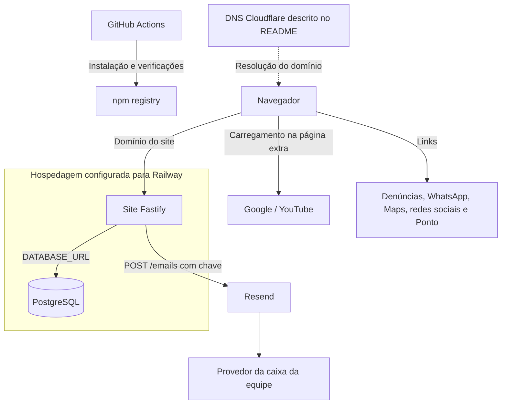

# 05 — Terceiros e sistemas relacionados

> Inventário conferido em 21/10/2026 em `src/notificacoes.ts`, `src/content.ts`,
> `src/server.ts`, views, scripts públicos, `railway.json` e workflow de CI.
> A presença de um domínio no código não comprova contrato, região ou serviço ativo.

## Fronteiras de comunicação

Há quatro relações distintas: infraestrutura que hospeda o sistema; chamada
do servidor à Resend; recurso YouTube carregado pelo navegador na página extra;
e links que o visitante decide abrir. Pacotes npm são dependências de software,
não evidência de envio dos formulários a seus mantenedores.

## Inventário dos provedores

| Serviço / terceiro | Relação e acionamento | Dados envolvidos | Configuração / evidência |
|---|---|---|---|
| Railway | Destino de hospedagem e banco; inicialização e healthcheck definidos | Dados persistidos no banco, requisições e saída de logs conforme configuração do serviço | `railway.json`, `src/db.ts`, README; conta/região/retenção de logs a confirmar na operação |
| Resend | API do servidor, somente se `RESEND_API_KEY` existir e após gravar formulário | Remetente, destinatário, assunto, HTML de aviso e metadados descritos abaixo | `src/notificacoes.ts`; `POST https://api.resend.com/emails` |
| Provedor de e-mail da equipe | Recebe os avisos entregues pela Resend | Destinatário e conteúdo do aviso | `EMAIL_*`; fornecedor e retenção da caixa não identificados no código |
| Cloudflare | DNS orientado pelo README | Resolução do domínio; dados de tráfego HTTP somente se proxy estiver habilitado | Não há API/SDK Cloudflare no site; modo DNS/proxy a confirmar |
| GitHub / GitHub Actions | Repositório e verificações de push/PR para `main` | Código e saídas da CI; workflow não configura acesso ao banco de produção | `.github/workflows/ci.yml`; vínculo de deploy na Railway a confirmar |
| npm registry | Instalação das dependências do build e CI | Solicitações de pacotes e metadados técnicos de instalação | `package.json`, `package-lock.json`, `npm ci` |
| Google / YouTube | Script e iframe na página `/bruno_magalhaes` | Requisições do navegador, IP e metadados técnicos; conteúdo conforme comportamento do provedor | `public/js/extra.js`, CSP em `src/server.ts` |
| Canal externo de denúncias | Link aberto por decisão do visitante | Navegação ao destino e dados preenchidos lá; o site não envia seu formulário direto a esse canal | `integridade.canal.url` em `src/content.ts`; hostname `denuncieonline.azurewebsites.net` |
| WhatsApp / Meta | Links `wa.me` para atendimento | Navegação e conversa iniciada pelo visitante | Views e `empresa.whatsapp`; sem API de mensagens no servidor |
| Google Maps | Link de busca dos endereços físicos | URL de busca e navegação do visitante | `empresa.enderecos[].mapsUrl`; sem mapa incorporado |
| Instagram / LinkedIn | Links dos perfis institucionais | Navegação ao perfil externo | `empresa.instagram` e `empresa.linkedin`; sem pixel ou SDK social |

O hostname Azure do canal externo indica o destino publicado; não identifica
a razão social do operador nem seu papel contratual. A identificação do operador,
os contratos de tratamento e os mecanismos de transferência internacional
dependem de evidência administrativa. Não são dedutíveis do link ou do código.

## Contrato implementado com a Resend

O servidor chama a API com `Authorization: Bearer`, `Content-Type: application/json`
e timeout de oito segundos. O payload contém `from`, `to`, `subject` e `html`.
O HTML inclui link para uma lista do painel; não inclui token de sessão.
Em desenvolvimento o assunto recebe o prefixo `[teste]`.

| Formulário | Informação enviada no aviso | Destinatário configurável |
|---|---|---|
| Contato | Aviso genérico e link da lista | `EMAIL_CONTATO` |
| Candidatura | Área informada e aviso genérico; sem currículo anexo | `EMAIL_RH` |
| Integridade | Protocolo, categoria e indicação anônimo/identificado | `EMAIL_COMPLIANCE` |
| Titular | Protocolo, tipo do pedido e referência ao prazo | `EMAIL_ENCARREGADO` |

Os handlers não incluem nos avisos nome, e-mail do visitante, telefone, documento,
texto da mensagem, relato ou detalhes do pedido. Área e categoria são valores
fornecidos pelo usuário: o código não deve ser interpretado como garantia de
que esses campos jamais contenham informação pessoal.

Sem chave, o envio é ignorado com aviso no log. Erro HTTP, timeout ou exceção
são registrados sem desfazer a gravação do formulário. Não há fila persistente,
retentativa automática, webhook de entrega nem confirmação de leitura. O painel
é a fonte para acompanhar os recebimentos, inclusive quando um e-mail falha.

## Exceção do YouTube

`extra.js` injeta `https://www.youtube.com/iframe_api` ao executar na página
extra e cria player com host `https://www.youtube-nocookie.com`. A CSP permite
scripts de YouTube e `s.ytimg.com`, imagens de `i.ytimg.com` e os frames declarados.
O carregamento não consulta a escolha de cookies. O bloqueio de autoplay pelo
navegador não impede o pedido inicial ao provedor.

O nome `nocookie` não significa ausência de comunicação com o Google. `noindex`
também não impede acesso à página nem carregamento de recursos. As demais
páginas usam recursos locais; os testes de terceiros mantêm a exceção explícita.

## Relação com os outros sistemas Afirma E-vias

| Sistema | Relação implementada neste site | Limite |
|---|---|---|
| Ponto | Link para `https://aevias-ponto.up.railway.app/login` e sua política `/privacidade` no rodapé | Navegação sem token, credencial ou parâmetro de retorno; não há chamada à API do Ponto |
| Controle | Apresentação comercial e capturas locais na vitrine | Não há cliente da API, consulta a ensaios, sincronização ou link operacional em `sistemasInternos` |
| Laboratório | Apresentação comercial e capturas locais na vitrine | Não há cliente da API, banco compartilhado ou link operacional em `sistemasInternos` |
| `aevias-auth` | Nenhuma integração de autenticação encontrada | `/admin` usa `admin_usuarios`, bcrypt e cookie próprio; não recebe JWT ou claim de apps |

`src/content.ts` orienta adicionar a `sistemasInternos` somente URLs de produção
das telas de entrada dos apps. O site aponta para cada aplicação; a autenticação
dela ocorre fora do site. `privacidadeApps` referencia o texto mantido pelo
próprio app, sem copiá-lo para este repositório.

A documentação `docs/login-unico.md` do Controle descreve o serviço compartilhado
para os apps que o integram. Ela não transforma o painel deste site em cliente
desse serviço. Autenticar no site não autentica automaticamente nos outros apps.

## Efeito de indisponibilidade

| Dependência indisponível | Efeito esperado pelo código |
|---|---|
| Aplicação / hospedagem | Páginas e formulários ficam indisponíveis |
| PostgreSQL | Formulários e painel falham; `/health` deixa de retornar sucesso; páginas sem consulta podem continuar renderizando |
| Resend / caixa da equipe | Registro permanece no banco; aviso pode não chegar |
| DNS do domínio | O acesso pelo domínio depende da resolução; não existe fallback de DNS na aplicação |
| Canal externo / WhatsApp / redes / Maps / Ponto | O destino do link pode falhar; não há dependência de API no site |
| YouTube | Player da página extra pode falhar; páginas institucionais não dependem dele |
| GitHub Actions / npm | Verificações ou novos builds podem falhar; o processo já em execução não os chama para atender páginas |

## Como manter o mapa

Ao introduzir serviço externo, registrar quem inicia a comunicação, o gatilho,
os campos transmitidos, autenticação, timeout, efeito de falha, configuração e
tratamento das cópias. Conferir CSP, testes de terceiros e política publicada.
Contratos, retenção dos provedores, regiões e responsáveis devem ser confirmados
pela equipe que administra as contas, sem inserir segredos na documentação.
