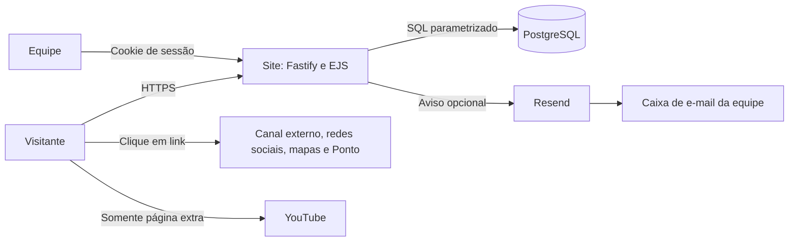

# Site Afirma E-vias — Arquitetura do sistema

> Para desenvolvedores, revisores e quem opera o ambiente.
> Conferido com o código em **21/10/2026**. Descreve o checkout local;
> configurações efetivas de serviços em produção não foram consultadas.

## O que é o sistema

O site apresenta a empresa, os serviços e os aplicativos da Afirma E-vias.
Recebe contatos comerciais, currículos, relatos de integridade e pedidos de
titulares de dados. A equipe atende esses registros pelo painel `/admin`.

As páginas são renderizadas no servidor com EJS. O conteúdo institucional fica
em `src/content.ts`; os registros dos formulários, as contas do painel, as sessões
e a auditoria ficam em PostgreSQL. Os currículos são armazenados no próprio banco.

## Visão geral



Railway é o destino de deploy previsto em `railway.json`. O README orienta DNS
via Cloudflare. A confirmação da conta, da região, do proxy e dos contratos dos
provedores depende da configuração operacional, que não está no código.

## Índice

| Documento | O que explica |
|---|---|
| [01 — Stack e estrutura](01-stack-e-estrutura.md) | Tecnologias, módulos, conteúdo e navegador |
| [02 — Backend, telas e fluxos](02-backend-telas-e-fluxos.md) | Rotas públicas, painel e processamento dos formulários |
| [03 — Banco de dados e retenção](03-banco-de-dados-e-retencao.md) | Tabelas, relacionamentos, arquivos e descarte |
| [04 — Segurança, acesso e auditoria](04-seguranca-acesso-e-auditoria.md) | Sessão, perfis, controles e eventos registrados |
| [05 — Terceiros e sistemas relacionados](05-terceiros-e-sistemas-relacionados.md) | Serviços, dados transmitidos, dependências e fronteiras |
| [06 — Operação, ambiente e deploy](06-operacao-ambiente-e-deploy.md) | Configuração, execução local, Railway e diagnóstico |
| [07 — Testes e manutenção](07-testes-e-manutencao.md) | Verificações existentes e atualização dos documentos |

## Mapa do repositório

```text
afirmaevias-site/
├── src/
│   ├── server.ts             Inicialização, plugins, cabeçalhos e tarefas
│   ├── config.ts             Ambiente e parâmetros comuns
│   ├── content.ts            Conteúdo institucional e links
│   ├── routes/               Site, formulários e painel
│   ├── views/                Templates EJS públicos e administrativos
│   ├── auth.ts               Contas, senhas, sessões e freio de login
│   ├── audit.ts              Gravação dos eventos administrativos
│   ├── db.ts / migrate.ts    Pool PostgreSQL e aplicação do schema
│   ├── notificacoes.ts       Avisos pela Resend
│   ├── retencao.ts           Execução do descarte
│   ├── regras-retencao.ts    SQL e prazos do descarte
│   └── *.test.ts             Testes com node:test
├── db/schema.sql             Estrutura idempotente do banco
├── public/                   CSS, JavaScript, fontes, imagens e PDFs
├── docs/arquitetura/          Esta documentação
├── .github/workflows/        Verificações de CI
└── railway.json              Build, inicialização e healthcheck
```

## Relação com a documentação do Controle

A organização e o nível de rastreabilidade seguem `docs/arquitetura/README.md`
do repositório irmão `aevias_controle`, especialmente os capítulos de stack,
backend, banco, segurança, operação e testes. `docs/login-unico.md` foi usado para
delimitar a relação com o serviço compartilhado de autenticação.

Essas referências descrevem outro produto. React, JWT, Supabase Auth, R2, fila
offline, assinatura de ensaios, APK e migração Base44 pertencem à arquitetura do
Controle; não são componentes deste site. O [capítulo 05](05-terceiros-e-sistemas-relacionados.md)
explica a relação efetivamente encontrada.

## Como interpretar as informações

- **Implementado:** comportamento encontrado no código ou na configuração versionada.
- **Condicional:** só acontece quando a chave, a rota ou o uso descrito está presente.
- **A confirmar na operação:** depende de painéis externos, contratos ou decisões da equipe.

Os prazos descritos são os implementados e os publicados pelo sistema. A
documentação técnica não certifica conformidade jurídica nem disponibilidade de
um serviço externo.
